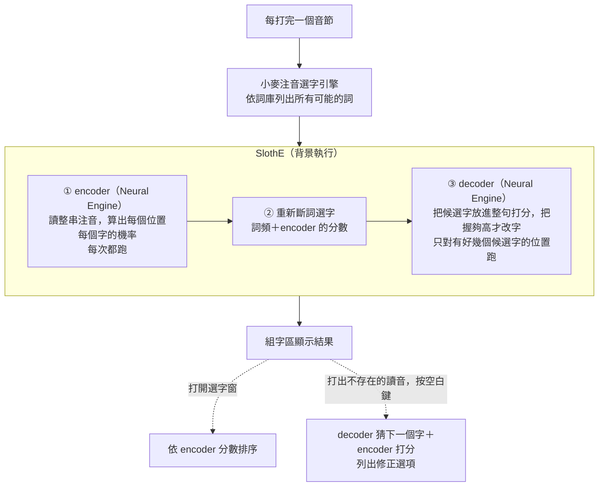

# McBopomofoLM：小麥注音 × 本機 AI 選字

[小麥注音輸入法（McBopomofo）](https://github.com/openvanilla/McBopomofo) 的 fork，在原本的選字引擎上加了兩個跑在 Apple Neural Engine 上的小型語言模型，讓選字更準。打字方式、詞庫和設定都跟小麥注音一樣；完全離線，你打的字不會離開這台電腦。安裝後是獨立的輸入法「注音 LM」，可以跟原版小麥注音並存。

模型來自 [Sloth 輸入法](https://github.com/vieenrose/sloth-zhuyin-linux)（Linux 上的神經注音輸入法），權重由作者發布在 [Luigi/sloth-ime-models](https://huggingface.co/Luigi/sloth-ime-models)。這個 fork 把其中兩個模型轉成 Core ML，接進小麥注音的選字引擎。

## 比原版小麥注音多了什麼

- **AI 選字**：兩個模型看整句來判斷每個字，選錯的字會自動改對。
- **記得前文**：會參考最近送出的字，兩三個字分段送出也選得準。
- **打錯可以救回**：打出不存在的讀音時，按空白鍵會跳出「你是不是要打…」的修正選項。
- **單點 Shift 切換中英文**：打到一半的字不會被送出；游標旁和選單列會顯示目前是中文還是英文。
- **數字鍵盤的數字直接放進組字區**，可以一口氣打完「12月」。
- **圖形安裝程式**：雙擊安裝，幾秒就好。

### 效果

在沒有拿來調參數的測試資料上量的：

| | 原版小麥注音 | McBopomofoLM |
|---|---|---|
| 字元正確率（Common Voice zh-TW，1,500 句） | 95.25% | **96.55%** |
| 整句全對（同上） | 70.4% | **79.1%** |
| 字元正確率（分段打字，每次送出兩三個字） | 88.6% | **92.7%** |
| 「再」選對率（2026 年 10 月的聊天和新聞文字） | 約 67% | **約 79%** |

## 架構



- **小麥注音的引擎**照常運作：依詞庫和詞頻斷詞、選字。
- **encoder**（SlothE-T，25M 參數，雙向）：每打完一個音節就跑一次，讀整串注音，算出每個位置每個字的機率，加進引擎的選字分數。選字窗的排序也用它的分數。
- **decoder**（SlothE `pred_q35_60m`，60M 參數，Qwen3.5 架構）：只在有好幾個候選字的位置跑，在 encoder 前 3 名之間做最後判斷：把候選字連同前後文一起打分，只在把握夠高時才改字。打錯讀音時，也用它猜下一個字來列出修正選項。
- 兩個模型都只跑在 Neural Engine 上，在背景執行，不會擋住打字；模型沒準備好或沒辦法用時，就退回原版小麥注音的選字。

演算法的完整說明見 [slothe-algorithm.md](slothe-algorithm.md)；模型格式、載入流程、快取、測試和評估方法見 [DEVELOPMENT.md](DEVELOPMENT.md)。

## 使用

- **單點 Shift**：單獨按一下 Shift，在中文和英文之間切換。
- **輸入選單**裡的「AI 選字」是總開關，關掉就跟原版小麥注音一樣。
- **選單列的「中／A」**：如果沒有出現在「ㄅ」旁邊，按住 ⌘ 把它拖過去，之後會記住位置。
- 第一次使用時，AI 模型會在背景準備 1–3 分鐘，好了會通知你；這段時間照常打字，用一般選字。

## 需求

- Apple 晶片的 Mac（M1 以上），macOS 15 以上
- 記憶體：8 GB 的 Mac 就夠用。輸入法平常用約 100–200 MB，第一次準備 AI 模型時暫時約 600 MB
- CPU：幾乎不用。AI 跑在 Neural Engine 上，閒置時 0%，正常打字 30 分鐘約用 40 秒 CPU
- 硬碟：約 1.4 GB（大部分是 AI 模型為這台 Mac 準備的快取）

## 安裝

### 用安裝程式

1. 到 [Releases](https://github.com/workfunction/McBopomofoLM/releases) 下載最新的 `McBopomofoLM-Installer-<版本>.zip`，雙擊解壓縮，再雙擊「安裝小麥注音 LM」。
2. macOS 會擋下來（因為沒有 Apple 的開發者簽章）：按「完成」，到「系統設定 → 隱私權與安全性」按「仍要打開」。
3. 按「同意安裝」，幾秒後就完成。
4. 輸入選單裡會出現「注音 LM」；沒有的話，登出再登入。

更新：打開新版的安裝程式。移除：打開安裝程式，按「移除」。

### 用終端機

在解壓縮出來的資料夾裡執行：

```bash
unzip -q McBopomofoInstaller.app/Contents/Resources/NotarizedArchives/McBopomofoLM-r*.zip
xattr -dr com.apple.quarantine McBopomofoLM.app
pkill -x McBopomofoLM; rm -rf ~/Library/Input\ Methods/McBopomofoLM.app
ditto McBopomofoLM.app ~/Library/Input\ Methods/McBopomofoLM.app
~/Library/Input\ Methods/McBopomofoLM.app/Contents/MacOS/McBopomofoLM install
```

出現 `model files verified` 就完成了，再到「系統設定 → 鍵盤 → 文字輸入 → 輸入方式」加入「注音 LM」。自行編譯、用終端機移除等見 [DEVELOPMENT.md](DEVELOPMENT.md)。

## 隱私

完全離線、不連網；你打的字不會寫入任何檔案。「寫入診斷記錄」預設關閉，打開時只記錄耗時和計數，記錄內容見 [DEVELOPMENT.md](DEVELOPMENT.md#診斷記錄)。

## 授權

- 小麥注音：MIT（[LICENSE.txt](LICENSE.txt)），本 fork 的程式碼沿用。
- SlothE 模型權重：Apache-2.0（[Luigi/sloth-ime-models](https://huggingface.co/Luigi/sloth-ime-models)）；`char2id` 字表：Apache-2.0（[Luigi/slothing-web](https://huggingface.co/spaces/Luigi/slothing-web)）；異體字對照：衍生自 OpenCC，Apache-2.0。詳見 [NOTICE](SlothE/Bundle/SlothE/NOTICE.txt)。

感謝小麥注音的開發者，也感謝 Sloth 輸入法作者公開模型與研究。
